# ArchSieve

**Architecture evidence for coding agents.** *Evidence before abstractions.*

> Experimental V0 (provisional name). Apache-2.0. Not on npm yet: install from git.

Coding agents add interfaces, layers, services and abstractions that the code does not need, even when the code works. ArchSieve gives them, and you, a deterministic picture of the real architecture, plus a before/after diff of each change, so every new abstraction becomes a visible cost that has to answer a real need.

It does not impose Clean Architecture, DDD or hexagonal. Simplicity is not "fewer classes".

## What it does

```
repo or commit ──► existing analyzers ──► snapshot.json ──► diff / Mermaid / DOT ──► agent or human
                   (dependency-cruiser,     (provenance,
                    go list, NestJS DI)      error/signal/unknown)
```

- **scan**: runs existing analyzers and normalizes their output into one JSON snapshot. Every node and edge records which tool reported it.
- **diff**: compares two snapshots: nodes, edges, component-level dependencies and findings that are new or resolved. `--fail-on error` turns it into a CI gate.
- **render**: Mermaid or DOT views (components, files, NestJS DI), optionally coloured against a previous snapshot.
- **validate**: checks documents against the JSON Schemas in `schema/`.

Findings have three levels and nothing else:

| Level | Meaning | Examples |
|---|---|---|
| `error` | Verifiable from the evidence for this commit | runtime import cycle, DI cycle, module cycle |
| `signal` | Heuristic; needs judgement, not obedience | orphan file, cycle through type-only imports, provider behind a token with one binding |
| `unknown` | Not inferable from static evidence | unresolved import, factory/value provider, Go package load error |

There is no quality score.

## Quick start

```bash
git clone https://github.com/FullFran/archsieve && cd archsieve
npm install
npm test                       # 11 integration tests, no network
npm run demo                   # regenerates examples/nest-shop/

# any local repo (JS/TS/MJS + Go), working tree or a commit, never modifies it
node bin/archsieve.mjs scan ../my-repo -o /tmp/as/now.json
node bin/archsieve.mjs scan ../my-repo --ref main -o /tmp/as/main.json
node bin/archsieve.mjs diff /tmp/as/main.json /tmp/as/now.json --format md
node bin/archsieve.mjs render /tmp/as/now.json --depth 1 > /tmp/as/components.mmd
```

`npm link` puts `archsieve` on your PATH. To use it as a dev dependency of another project, pin a tag:
`npm install --save-dev github:FullFran/archsieve#v0.1.0`.

## Example (synthetic NestJS fixture)

`fixtures/nest-shop/after` adds three things to `before`: a repository behind a string token, a `forwardRef` cycle between `UsersService` and `OrdersService`, and a factory provider. From `examples/nest-shop/diff.md`:

- **4 errors**: the Nest DI cycle, the module import cycle, and two runtime file cycles.
- **2 signals**: `InMemoryUsersRepository` behind token `USERS_REPOSITORY` with one binding (an abstraction that has to justify itself), and a cycle that exists only through type-only imports (erased at runtime, so not an error).
- **1 unknown**: the `CLOCK` factory provider, whose dependencies the DI graph cannot show.



## Supported today

| Stack | Analyzer | Notes |
|---|---|---|
| JS / TS / MJS / TSX | dependency-cruiser 18.7.2 | Type-only imports are labelled. Vendored dirs (`vendor/`, `third_party/`, `node_modules/`) are boundaries and are not followed. Git-ignored dirs are excluded. |
| Go | `go list` | Offline (`GOPROXY=off`). Standard library omitted. |
| NestJS DI | `@nestjs/core` SerializedGraph, `preview: true` | Opt-in `--nest-entry <compiled module>`. **Runs module top-level code**; providers are not instantiated. |

## Known limitations

- Static evidence only: no runtime calls, HTTP, IPC, queues or events. A clean result does not mean the system is correct.
- dependency-cruiser cannot see computed `import(\`./x/${name}\`)`; such imports are neither edges nor findings.
- `--ref` resolves packages against the **current** `node_modules`, not the install at that commit.
- Rust, Python and PowerShell are not analyzed. JSON Schema `$ref` graphs (relevant for HCS) are not analyzed yet.
- Mermaid becomes unreadable beyond a few hundred edges: use `--depth 1` or `--format dot`.
- Tests were written after a spike, as characterization tests, not test-first.

## Security

- Offline by default. Nothing is uploaded.
- ArchSieve never runs repository scripts or loads repository JS configs. The only exception is the explicit `--nest-entry`.
- Write snapshots of private repositories outside the repository and do not publish them.

## Agents

`skills/archsieve/SKILL.md` is an [Agent Skills](https://agentskills.io/specification) skill (Claude Code, OpenCode, Pi, Codex). It is linked into `.claude/skills/` for this repository. No MCP server is needed: the agent runs the CLI.

## Design records

- [ADR 0001](docs/adr/0001-compose-existing-analyzers.md): compose existing analyzers.
- [ADR 0002](docs/adr/0002-minimal-json-model.md): minimal JSON model with three evidence levels.
- [ADR 0003](docs/adr/0003-not-implemented-in-v0.md): what V0 deliberately does not implement.
- [Tool matrix](docs/research/tool-matrix.md): comparison with existing tools.

## License

Apache-2.0. See [LICENSE](LICENSE).
