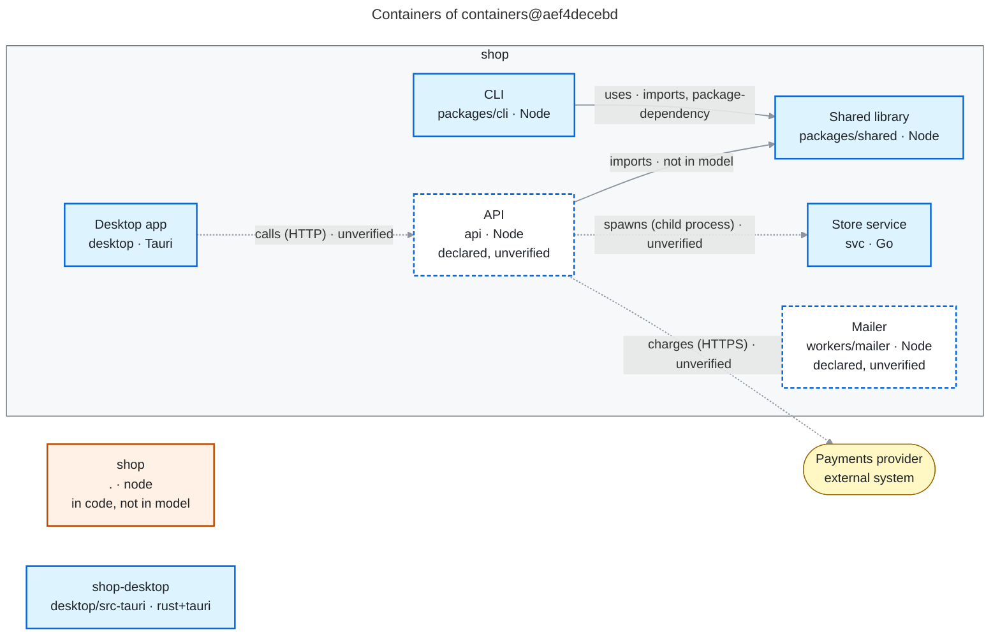

## Containers of containers@aef4decebd

Which units run or ship, and how do they depend on each other?

Snapshot containers@aef4decebd · showing 9 of 9 containers and systems

**Legend**

| Mark | Meaning |
| --- | --- |
| Blue box | Container: a unit that runs or ships, with its path and technology |
| Dashed blue box | Declared in the model, no manifest proves it (`declared, unverified`) |
| Orange box | Found in the code, not declared in the model (`in code, not in model`) |
| Yellow rounded box | System outside the repository, declared in the model |
| Labelled frame | The system the model declares these containers in |
| Words before the first `·` | Relation declared in the model, with its technology in brackets |
| `imports`, `lazy`, `type-only` | Code imports that cross from one container into the other, counted |
| `package-dependency` | A package.json dependency on the other container |
| Dashed arrow ending in `unverified` | Declared in the model, no static evidence in the code (runtime links such as HTTP or IPC are never visible statically) |
| Arrow ending in `not in model` | Found in the code, not declared in the model |

**Container facts**

Counted from the files in each container (lockfiles left out of files and lines); facts, not a score.

| Container | Files | Lines | Languages (lines) | Manifests | Toolchains |
| --- | ---: | ---: | --- | --- | --- |
| . | 3 | 72 | likec4 64, json 8 | package.json (0 deps) | node |
| api | 1 | 3 | javascript 3 | - | - |
| desktop | 2 | 2 | javascript 1, json 1 | package.json (0 deps) | node |
| desktop/src-tauri | 3 | 12 | rust 7, toml 4, json 1 | Cargo.toml (0 deps) | rust, tauri |
| packages/cli | 2 | 5 | javascript 4, json 1 | package.json (1 dep) | node |
| packages/shared | 2 | 2 | javascript 1, json 1 | package.json (0 deps) | node |
| svc | 3 | 12 | go 12 | go.mod (0 deps) | go |
| workers/mailer | 0 | 0 | - | - | - |
